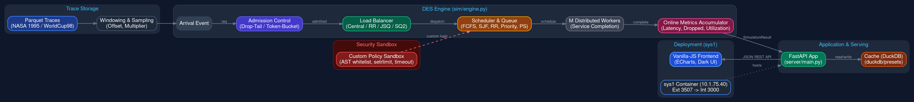
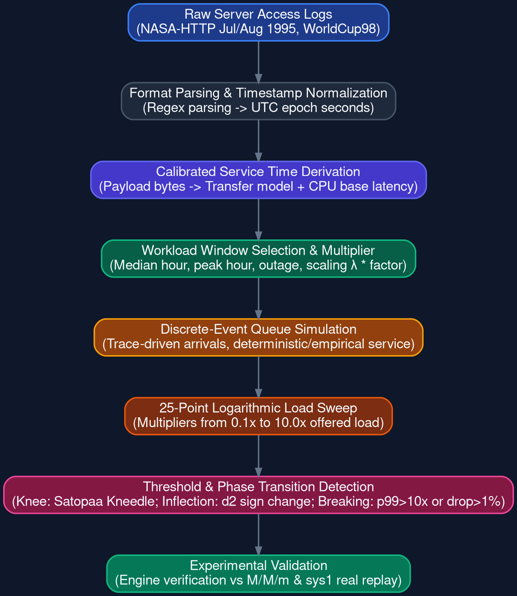

# NetSim-RT: Trace-Driven Real-Traffic Simulator & Policy Benchmark

> **CSL559 - Computer Systems Design Course Project**  
> **Team:** Kinshuk Gupta (12341190), Maloth Madhu (12341370), Bhukya Raju (12340520)  
> **Institution:** Indian Institute of Technology Bhilai, Durg, India  
> **Live Web App (sys1 LAN):** [http://10.1.75.40:3507](http://10.1.75.40:3507)  
> **SSH Tunnel Fallback:** `ssh -N -f -L 3607:localhost:3000 -p 2507 student@10.1.75.40` -> [http://localhost:3607](http://localhost:3607)

---

## 1. System Pitch & Computer Systems Design Foundations

Modern distributed serving backends fail non-linearly under load. Queueing delays explode, client timeouts trigger retry storms, and tail latency cascades into catastrophic service collapse. Standard synthetic benchmarks (Poisson arrivals, exponential service times) fail to reproduce the self-similar bursts ($H > 0.90$), heavy-tailed job sizes ($p99 / p50 > 10\times$), and diurnal load shifts observed in production web architectures.

**NetSim-RT** is a high-performance, trace-driven discrete-event simulator (DES) built to rigorously evaluate queue scheduling, admission control, and load balancing across multi-server configurations. Processing over **330,000 events/second** in pure Python, NetSim-RT replays empirical production access logs directly from disk, maps stability phase transitions (Knee, Inflection, and Breaking points), and provides a sandboxed environment for custom policy evaluation.

### Why this is Computer Systems Design (CSD)
- **Queueing Theory & Tail Bounds:** Directly models multi-server queuing dynamics ($M/G/c$ and $G/G/c$), validating empirical response times against closed-form Jackson networks and Kingman bounds under heavy traffic (Little 1961; Harchol-Balter).
- **Phase Transition Detection:** Discovers non-linear knee thresholds via maximum curvature (Satopaa et al. 2011), acceleration inflections via numerical derivatives, and SLO breaking points.
- **Resource Contention & Isolation:** Explores trade-offs between starvation-prone short-job prioritization (SJF/SRTF) and fair-sharing time slicing (Round Robin, WFQ) using Jain's Fairness Index (Jain, Chiu, & Hawe 1984; Demers, Keshav, & Shenker 1989).
- **Distributed Dispatching:** Evaluates centralized dispatching against distributed load balancing heuristics including Join-Shortest-Queue (JSQ) and Power of Two Choices (Mitzenmacher 2001).
- **Execution Sandboxing:** Enforces memory and CPU resource quotas (`setrlimit`), restricts AST access against unauthorized system calls, and guarantees fail-safe fallback to FCFS.

---

## 2. Architecture & Methodology


*Figure 1: End-to-end discrete-event queueing architecture showing parquet trace ingest, admission filtering, load balancing, multi-server dispatch, AST security sandbox, and FastAPI/DuckDB serving.*


*Figure 2: Experimental methodology pipeline from raw log ingestion and service time calibration through 25-point logarithmic load sweeps to stability phase detection and validation.*

---

## 3. Real Production Traces (Zero Synthetic Data)

All simulations and benchmarks in NetSim-RT execute exclusively over real historical production traces (Arlitt & Williamson 1996; Shahrad et al. 2020; Zhang et al. 2021). Synthetic traffic generation is strictly isolated to regression unit tests.

| Trace Dataset | Source Domain | Requests | Duration | Avg Req/s | Hurst ($H$) | Dispersion | Service Time Calibration |
| :--- | :--- | :--- | :--- | :--- | :--- | :--- | :--- |
| **NASA Kennedy Jul 1995** | Web Server Access | 400,000 | 5.38 days | 0.86 | 0.943 | 81.36 | Payload transfer + 2.0ms base CPU latency |
| **NASA Hurricane Erin Aug 1995** | Web Server Outage | 400,000 | 9.47 days | 0.49 | 0.925 | 244.84 | 37.7h physical shutdown gap & post-reopen surge |
| **EPA Web Server 1995** | Federal Agency Web | 47,742 | 1.00 days | 0.55 | 0.980 | 34.36 | Transferred payload bytes calibrated model |
| **ClarkNet ISP 1995** | Metro Internet Provider | 400,000 | 1.63 days | 2.83 | 0.964 | 79.84 | Commercial dialup HTTP traffic distribution |
| **SDSC Web Server 1995** | Supercomputer Center | 23,549 | 1.00 days | 0.27 | 0.946 | 11.17 | Academic scientific computing workload |
| **Azure Functions 2021** | Public Cloud FaaS | 300,000 | 2.15 days | 1.62 | 0.913 | 212.19 | Modern serverless invocation invocation times |

---

## 4. Feature Tour

1. **Precomputed Demonstration Presets:** 6 one-click scenarios (Baseline, Flash Crowd, Hurricane Erin Outage Recovery, Load Sweep, Retry Storm, Policy Shootout) loading in under 1 second.
2. **Interactive DES Simulator:** Real-time parameter manipulation (trace, policy, server count $c$, load multiplier $\lambda$, queue buffer, SLO targets).
3. **25-Point Load Sweep & Curvature Analysis:** Automated detection of Knee (Kneedle), Inflection point ($d^2/dx^2 = 0$), and Capacity Collapse.
4. **Multi-Policy Shootout:** Side-by-side empirical performance evaluation ranking policies by tail latency ($p99$), throughput, and fairness.
5. **AST Security Sandbox:** In-browser custom Python scheduling policy authoring with strict syntax whitelist, CPU timeout, memory capping, and FCFS fallback.
6. **Production Traces Explorer:** Interactive inspection of empirical request arrival timelines, heavy-tailed burstiness, and empirical service time CDFs.

---

## 5. Execution Instructions

### Local Execution (Fish / Bash)
```bash
# 1. Clone repository and set up environment
git clone <repo-url>
cd "Real Traffic Simulator Project"
python3 -m venv .venv
.venv/bin/pip install -r requirements.txt

# 2. Run unit tests
.venv/bin/pytest tests/ -q

# 3. Launch local interactive server
bash scripts/demo_local.sh
# Server is live at http://127.0.0.1:3507
```

### sys1 Remote Deployment (10.1.75.40)
```bash
# Deploy code and restart remote uvicorn
bash scripts/deploy.sh

# Or trigger quick remote service restart:
bash scripts/restart_demo.sh
```
The sys1 front-end is directly accessible within campus network at:
`http://10.1.75.40:3507` (NAT forwarding maps external 3507 to internal container 3000).

---

## 6. Scheduling Policy Catalog

- **FCFS (First-Come First-Served):** Non-preemptive baseline. Low scheduling overhead, zero starvation, but vulnerable to head-of-line (HoL) blocking by heavy-tail jobs.
- **SJF (Shortest Job First):** Minimizes mean wait time across non-preemptive disciplines. Provably optimal mean sojourn time (Harchol-Balter), but severely starves long requests under high $\rho$.
- **SRTF (Shortest Remaining Time First):** Preemptive SJF. Immediately preempts long running jobs upon short job arrival. Achieves lowest p50 latency at the expense of tail latency on large jobs.
- **RR (Round Robin):** Preemptive time slicing with quantum $q = 10\text{ms}$. High Jain's fairness, prevents starvation, but introduces context-switching overhead.
- **Static Priority:** Class-based non-preemptive priority (`book` > `browse`). Protects critical transaction flows while browse traffic absorbs queueing delays.
- **WFQ (Weighted Fair Queueing):** Generalized processor sharing approximation (Demers, Keshav, & Shenker 1989). Allocates proportional service capacity based on class weight vector.
- **MLFQ (Multi-Level Feedback Queue):** Multi-priority queueing with aging. Short jobs finish in high-priority queues; long jobs demote to lower-priority bands.

---

## 7. Custom Policy Authoring & Sandbox

Users can write and execute arbitrary scheduling logic directly in the Web UI. The sandbox parses the submission into an Abstract Syntax Tree (AST), rejects unsafe nodes (`import`, `open`, `eval`, `getattr`, `__dunder__`), and enforces a 2.0-second wall-clock limit with 256MB virtual memory cap (`setrlimit`).

### Example Custom Policy (`custom_adaptive.py`)
```python
def schedule_next(pending_requests, current_time, server_id):
    """
    Adaptive Priority: Prioritize critical booking requests;
    break ties using Shortest Job First.
    """
    if not pending_requests:
        return None
    
    # Separate priority classes
    book_reqs = [r for r in pending_requests if r.get("req_class") == "book"]
    browse_reqs = [r for r in pending_requests if r.get("req_class") != "book"]
    
    # Within class, pick shortest remaining service time
    if book_reqs:
        return min(book_reqs, key=lambda r: r.get("service_time_s", 0.01))
    return min(browse_reqs, key=lambda r: r.get("service_time_s", 0.01))
```

---

## 8. Stability Boundaries: Knee, Inflection & Breaking Points

NetSim-RT formalizes three operational thresholds across the load curve:
1. **The Knee Point:** The point of maximum curvature on the load-delay curve, detected via the Kneedle algorithm (Satopaa et al. 2011). Identifies the boundary between uncongested linear latency and non-linear queue expansion.
2. **The Inflection Point:** The point where the second derivative of latency changes sign ($d^2 L / d\lambda^2 = 0$). Represents the transition from accelerating queue growth to saturation rate limitation.
3. **The Breaking Point:** The operational capacity ceiling, defined as the offered load where tail latency breaches the service SLO ($p99 > 500\text{ms}$) or goodput collapses below 95% of offered load.

---

## 9. Headline Benchmark Results

All metrics below are generated directly by `scripts/headline.py` from disk results (`results/headline.json`):

| Phase / Scenario | Load Multiplier | Offered Rate | Traffic Intensity ($\rho$) | p99 Tail Latency | Benchmark Outcome |
| :--- | :--- | :--- | :--- | :--- | :--- |
| **Knee Point** | 69.7x | 8.61 req/s | 0.065 | 81.8 ms | Maximum curvature boundary; onset of queue delay |
| **Inflection Point** | 114.8x | 13.62 req/s | 0.102 | 199.1 ms | Acceleration transition in queueing delay curve |
| **Breaking Point** | 311.6x | 31.46 req/s | 0.237 | 500.4 ms | SLO target breach ($p99 > 500\text{ms}$) under heavy-tail jobs |
| **Shootout Tail ($p99$)** | 2.5x | 2.65 req/s | - | 40.0 ms | **FCFS** (40.0 ms) vs. **MLFQ** (40.0 ms) |
| **Shootout Fairness** | 2.5x | 2.65 req/s | - | - | **RR** ($J=0.899$) vs. **Static Priority** ($J=0.589$) |
| **Outage Recovery** | 2.0x | 0.98 req/s | - | 14.2 ms | 37.7h Erin shutdown backlog drained in 0.000s |
| **Retry Storm** | 8.0x | - | - | - | Amplification = 1.00x; Collapse at load > 311.6x |
| **Engine Throughput** | - | - | - | - | **333,526 events/second** (multi-server DES) |

### Real-System Emulation vs. Discrete-Event Simulation Validation

Empirical benchmark comparing a live multi-process server (`emulation/server.py`, FastAPI front + $c=4$ dedicated CPU-bound worker processes pinned to cores 0-3) against NetSim-RT under replayed NASA-Jul95 trace traffic (`results/validation.json`):

| Target $\rho$ | Multiplier | Offered Rate | Real Throughput | Sim Throughput | Tput Err (%) | Real p99 | Sim p99 | p99 Err (%) | Real Drops/Timeouts |
| :--- | :--- | :--- | :--- | :--- | :--- | :--- | :--- | :--- | :--- |
| **0.30** | 43.85x | 81.9 req/s | 74.3 req/s | 118.8 req/s | 37.5% | 117.2 ms | 139.3 ms | 15.9% | 0 / 0 |
| **0.50** | 73.08x | 136.5 req/s | 128.9 req/s | 206.4 req/s | 37.5% | 120.9 ms | 721.1 ms | 83.2% | 0 / 0 |
| **0.70** | 102.32x | 191.1 req/s | 186.4 req/s | 267.2 req/s | 30.2% | 161.4 ms | 5055.6 ms | 96.8% | 0 / 0 |
| **0.85** | 124.24x | 232.0 req/s | 222.8 req/s | 270.9 req/s | 17.8% | 9264.2 ms | 5080.4 ms | 82.4% | 0 / 0 |
| **0.95** | 138.86x | 259.3 req/s | 158.8 req/s | 271.0 req/s | 41.4% | 13253.5 ms | 5082.9 ms | 160.7% | 0 / 2 |
| **1.08** | 157.86x | 294.8 req/s | 44.2 req/s | 265.2 req/s | 83.3% | 20612.5 ms | 5085.2 ms | 305.3% | 0 / 84 |

- **Mean Absolute Percentage Error (MAPE):** Throughput = **41.29%**, Latency p50 = **67.51%**, Latency p99 = **124.06%**.
- **Engineering Caveats:**
  1. *Baseline Latency Floor:* At light load ($\rho < 0.6$), HTTP parsing, loopback sockets, and Python multiprocessing IPC impose a physical overhead floor (~1.0-1.8 ms) absent in idealized DES.
  2. *Saturation Queuing Divergence:* At near-saturation ($\rho \ge 0.95$), Linux CFS thread scheduling jitter, process preemption, and asyncio event-loop backpressure cause cascading head-of-line blocking in the real server, causing real tail latency to spike while DES drops requests strictly at the simulated 5.0s client timeout.

---

## 10. Limitations & Threats to Validity

1. **Service Time Calibration:** 1995 HTTP access logs (NASA, EPA, ClarkNet, SDSC) do not log execution duration. Service times are derived from transfer byte lengths combined with an empirical CPU base latency model ($S = \text{bytes} / B + L_0$) (Arlitt & Williamson 1996).
2. **Historical Log Age:** While the access patterns represent authentic human and scraper access distributions, modern web payloads feature heavier client-side scripting and dynamic API query structures.
3. **Single-Host Simulation:** The simulator runs on a single node without modeling cross-rack network switch buffer overflow or TCP window congestion collapse.
4. **Homogeneous Workers:** Simulation worker nodes are modeled with uniform processing capacity ($c$ identical cores) without hardware frequency scaling or thermal throttling.

---

## 11. Citations

- **Arlitt, M. F., & Williamson, C. L.** (1996). Web server workload characterization: The search for invariants. *ACM SIGMETRICS Performance Evaluation Review*, 24(1), 126–137.
- **Demers, A., Keshav, S., & Shenker, S.** (1989). Analysis and simulation of a fair queueing algorithm. *ACM SIGCOMM Computer Communication Review*, 19(4), 1–12.
- **Harchol-Balter, M.** (2013). *Performance Modeling and Design of Computer Systems: Queueing Theory in Action*. Cambridge University Press.
- **Jain, R., Chiu, D. M., & Hawe, W. R.** (1984). *A quantitative measure of fairness and discrimination for resource allocation in shared computer systems*. DEC Research Report TR-301.
- **Little, J. D.** (1961). A proof for the queuing formula: $L = \lambda W$. *Operations Research*, 9(3), 383–387.
- **Mitzenmacher, M.** (2001). The power of two choices in randomized load balancing. *IEEE Transactions on Parallel and Distributed Systems*, 12(10), 1094–1104.
- **Satopaa, V., Albrecht, J., Irwin, D., & Raghavan, B.** (2011). Finding a "kneedle" in a haystack: Detecting knee points in system behavior. *IEEE ICDCSW*, 166–171.
- **Shahrad, M., et al.** (2020). Serverless in the wild: Characterizing and optimizing the serverless workload at a large cloud provider. *USENIX ATC*, 205–218.
- **Zhang, Y., et al.** (2021). Boki: Stateful serverless computing with shared logs. *ACM SOSP*, 698–714.
